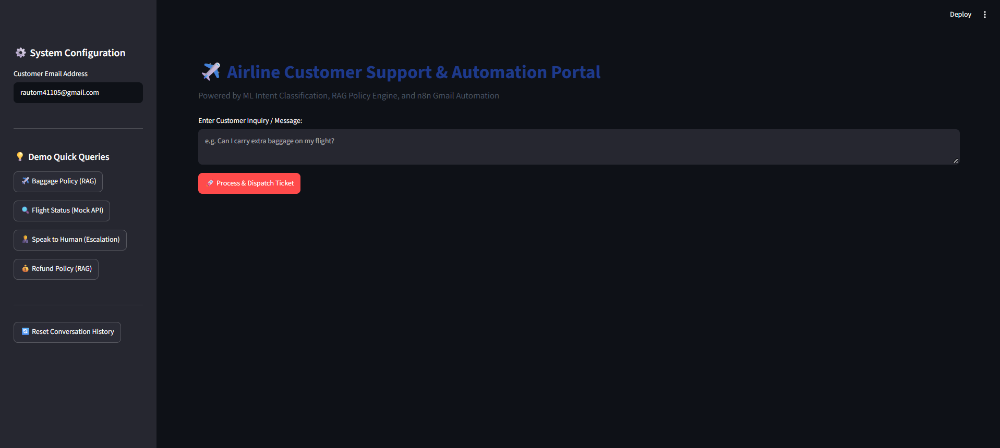
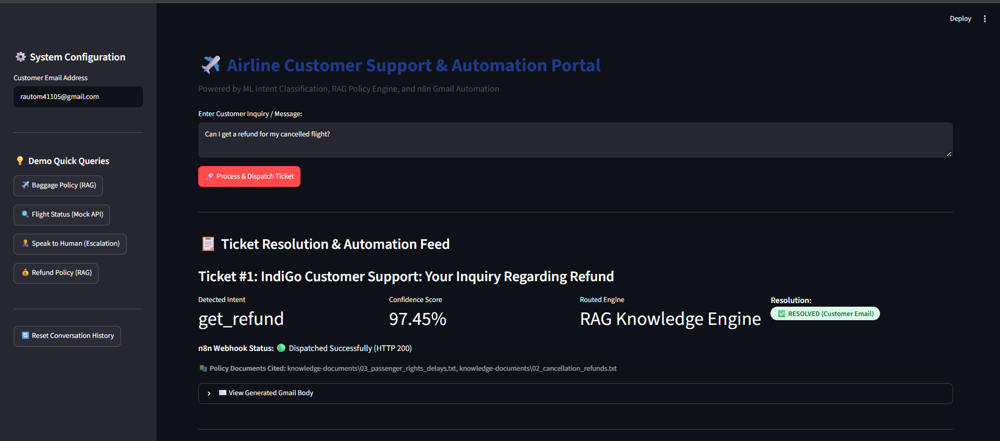
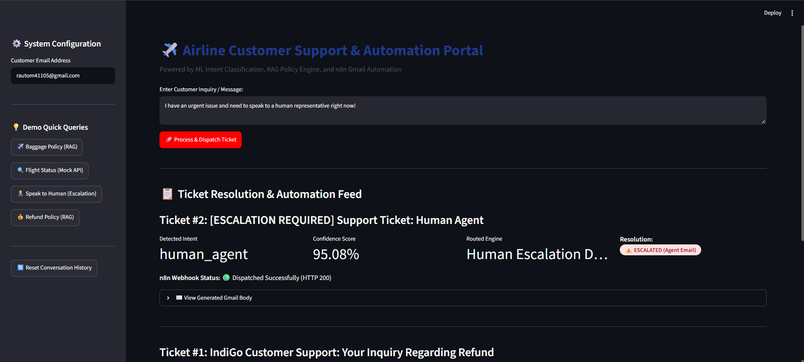
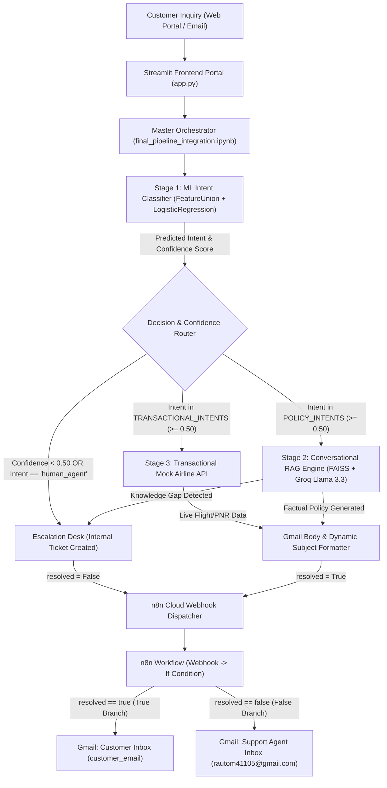
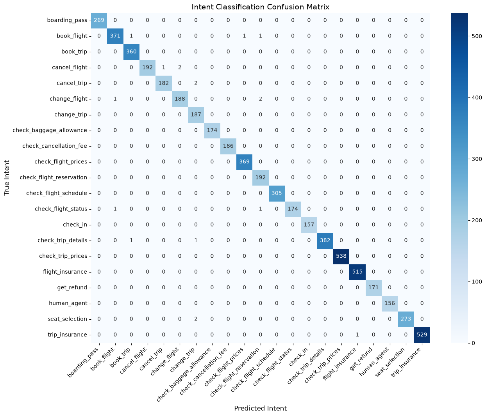
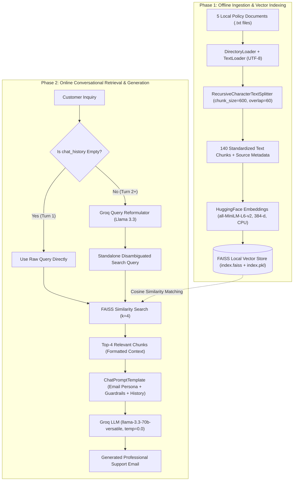
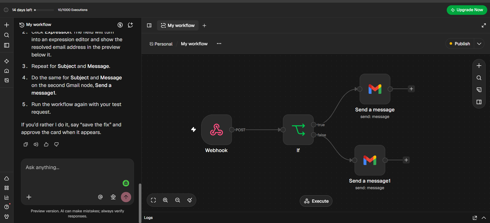
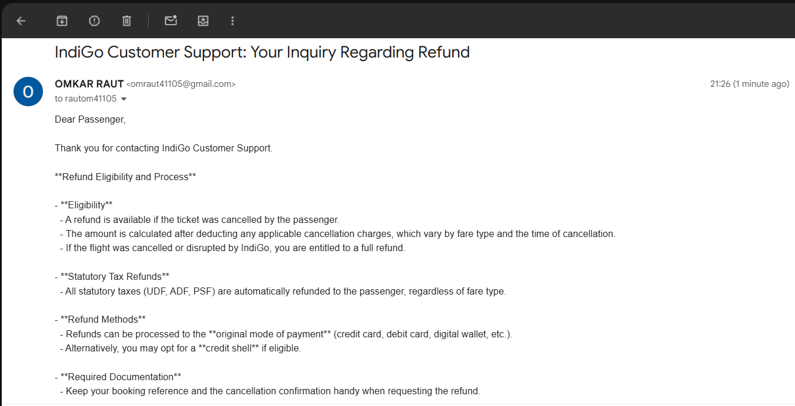
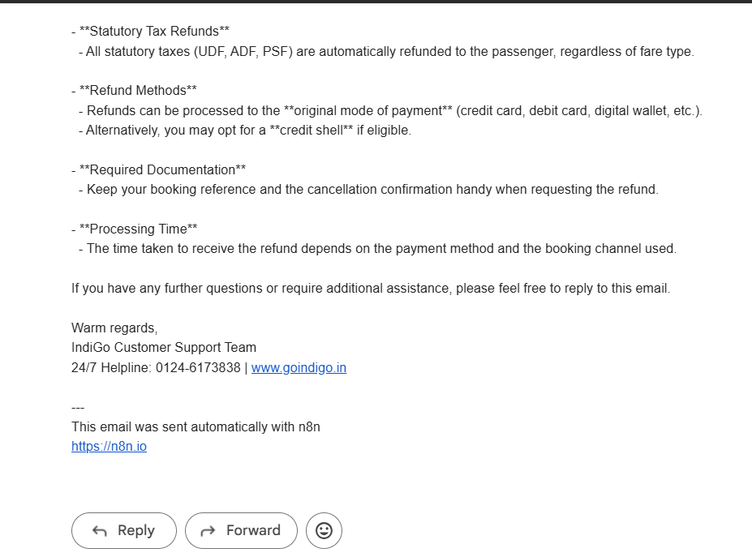
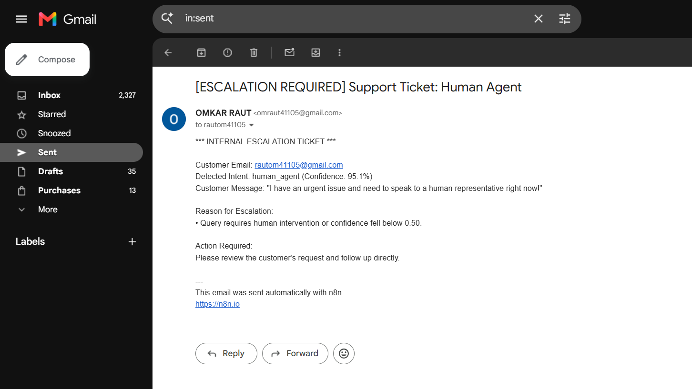

# ✈️ AI-Powered Airline Customer Support & Automation System

> **Artificial Intelligence Internship — Project 3: Chatbot for Customer Support**  
> An end-to-end hybrid AI customer support platform combining **Machine Learning Intent Classification (99.69% accuracy)**, **Conversational Retrieval-Augmented Generation (RAG)**, **Transactional Mock Airline APIs**, and **n8n Cloud Gmail Automation**.

---

## 📌 Problem Statement & Overview

Commercial airlines face severe operational bottlenecks in managing high volumes of passenger support queries during peak booking windows, flight delays, and schedule disruptions. Manual triage leads to long wait times, inconsistent policy explanations, and high support overhead.

This project solves the challenge with a **Two-Stage Hybrid AI Architecture + Automated Workflow Orchestrator**:

1. **Stage 1 — Hybrid ML Intent Classifier (`scikit-learn`):** Instantly classifies incoming passenger messages across **21 travel intent classes** with calibrated confidence scoring (`>= 0.50` threshold).
2. **Stage 2 — Conversational RAG Policy Engine (`FAISS` + `Groq Llama 3.3 70B`):** Answers complex policy inquiries grounded strictly in official Indian aviation documents (**IndiGo Conditions of Carriage**, **DGCA Passenger Charter**, and **Domestic TravInsure**) with multi-turn conversational memory.
3. **Stage 3 — Transactional Mock Airline Service:** Resolves live flight status (`6E-204`, `6E-551`), PNR reservation lookups (`IND123`, `FLY789`), route pricing, and provisional bookings.
4. **Stage 4 — n8n Cloud & Gmail Automation:** Automatically dispatches formatted customer resolution emails or escalates low-confidence / complex cases directly to the human support desk (`rautom41105@gmail.com`).

---

## 🖥️ Interactive Streamlit Web Portal

### 1. Main Portal Dashboard


### 2. Automated Policy Resolution (`resolved = True`)


### 3. Deterministic Human Agent Escalation (`resolved = False`)


---

## 🏗️ System Architecture

### End-to-End Orchestration Flowchart



---

## 🧠 Stage 1: Machine Learning Intent Classifier

- **Pipeline Architecture:** `FeatureUnion` combining:
  - **Word TF-IDF Vectorizer:** `ngram_range=(1, 2)`, `max_features=10000`, `sublinear_tf=True`
  - **Character Word-Boundary TF-IDF Vectorizer:** `analyzer='char_wb'`, `ngram_range=(4, 5)`, `max_features=15000`, `sublinear_tf=True`
  - **Classifier:** `LogisticRegression(class_weight='balanced', C=1.5, max_iter=1000, random_state=42)`
- **Key Engineering Fix:** Combining word unigrams/bigrams with character n-grams eliminated substring collisions (e.g., `"I want to eat"` previously triggered `seat_selection` at 83.1% under char-only features; under `FeatureUnion`, confidence dropped to **34.6%**, cleanly routing below the `0.50` threshold to human escalation).

### Quantitative Test Performance (5,888 Held-Out Test Samples)

| Metric | Score |
| :--- | :--- |
| **Overall Test Accuracy** | **99.69%** |
| **Macro Average F1-Score** | **0.9963** |
| **Weighted Average F1-Score** | **0.9969** |
| **Supported Intent Classes** | **21 Classes** |

### 21x21 Confusion Matrix Heatmap


---

## 📚 Stage 2: Conversational RAG Policy Engine

### Curated Knowledge Base (5 Core Aviation Documents)

| File | Source / Authority | Covered Intents |
| :--- | :--- | :--- |
| `01_baggage_policy.txt` | IndiGo Official Baggage Policy | `check_baggage_allowance` |
| `02_cancellation_refunds.txt` | IndiGo Conditions of Carriage | `cancel_flight`, `cancel_trip`, `change_flight`, `change_trip`, `get_refund`, `check_cancellation_fee` |
| `03_passenger_rights_delays.txt` | DGCA Passenger Charter (Govt. of India) | `check_flight_schedule`, `check_flight_status`, delay/cancellation compensation |
| `04_checkin_boarding_seats.txt` | IndiGo Check-in & Seating Guidelines | `check_in`, `boarding_pass`, `seat_selection` |
| `05_travel_insurance.txt` | SpiceJet / Tata AIG Domestic TravInsure | `flight_insurance`, `trip_insurance` |

> **Technical Highlight — PDF Private Use Area (PUA) Font Decoding:**  
> The official DGCA Passenger Charter PDF encoded glyphs in the Unicode Private Use Area (`0xF000–0xF0FF`), causing standard PDF extractors to output blank text. We engineered an affine linear demapping function (`chr(ord(c) - 0xF000)`) to recover 15,000+ characters of statutory compensation rules.

### RAG Architecture Flowchart



---

## ⚡ Stage 4: n8n Cloud Workflow & Gmail Verification

### n8n Automation Workflow
The Python orchestrator sends a structured JSON payload (`customer_email`, `subject`, `answer`, `resolved`) to the n8n Cloud Webhook. An **If** node inspects `{{ $json.body.resolved }}`:
- **True Branch (`resolved == true`):** Emails the formatted resolution directly to the passenger (`{{ $json.body.customer_email }}`).
- **False Branch (`resolved == false`):** Escalates an internal support ticket to the human agent (`rautom41105@gmail.com`).



### Verified Live Email Deliveries

| Automated Customer Email (Baggage Policy) | Automated Customer Email (Refund Policy) |
| :---: | :---: |
|  |  |

#### Escalated Internal Ticket to Human Support Agent (`rautom41105@gmail.com`)


---

## 📂 Repository Structure

```text
intern-project/
│
├── intent_classifier/                               # Stage 1: ML Intent Classification
│   ├── intent-classificiation.ipynb                 # Data cleaning, FeatureUnion training & evaluation
│   └── intent_classification_hybrid_model.joblib    # Serialized hybrid TF-IDF + LogisticRegression model
│
├── knowledge_base/                                  # Canonical RAG policy text documents (01 to 05)
│   ├── 01_baggage_policy.txt
│   ├── 02_cancellation_refunds.txt
│   ├── 03_passenger_rights_delays.txt
│   ├── 04_checkin_boarding_seats.txt
│   └── 05_travel_insurance.txt
│
├── RAG-part/                                        # Stage 2: RAG Ingestion, FAISS & LLM Pipeline
│   ├── knowledge-documents/                         # Source .txt policies & original DGCA Charter .pdf
│   ├── vector-db/                                   # Persisted FAISS index (index.faiss & index.pkl)
│   ├── knowledge-docs_chunking_vector.ipynb         # Document chunking & FAISS index generation
│   └── Pipeline-setup.ipynb                         # Conversational RAG chain & evaluation suite
│
├── n8n-integration_mockAPIs/                        # Stage 3: Mock Airline Service & Webhook Tests
│   └── gmail_automation_mockAPI.ipynb               # Mock flight/PNR lookup & n8n webhook dispatcher
│
├── final_pipeline_integration.ipynb                 # Stage 4: Unified End-to-End Orchestrator Notebook
├── app.py                                           # Stage 5: Production Streamlit Web Portal
├── Professional_Project_Documentation_AI_Customer_Support_Chatbot.docx  # Detailed Project Report
├── README.md                                        # Project Documentation
└── .gitignore                                       # Git ignore rules (protects .env & caches)
```

---

## 🚀 Getting Started & Installation

### 1. Clone the Repository
```bash
git clone <your-github-repo-url>
cd intern-project
```

### 2. Install Dependencies
```bash
pip install streamlit scikit-learn joblib requests python-dotenv langchain langchain-community langchain-core langchain-text-splitters langchain-groq faiss-cpu sentence-transformers pypdf
```

### 3. Configure Environment Variables
Create a `.env` file inside `RAG-part/.env`:
```env
GROQ_API_KEY=your_groq_api_key_here
```

### 4. Launch the Streamlit Application
```bash
streamlit run app.py
```

---

## 📄 Detailed Project Report
For complete mathematical formulations, class-by-class evaluation metrics, and architecture specifications, refer to the included report:  
📎 **[`Professional_Project_Documentation_AI_Customer_Support_Chatbot.docx`](./Professional_Project_Documentation_AI_Customer_Support_Chatbot.docx)**

